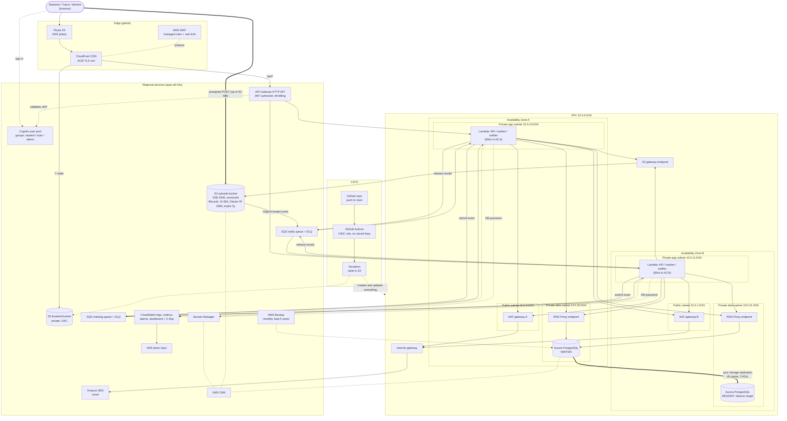

# Task 1 – Architecture design

## Diagram

**Tiers.** Edge: Route 53, WAF, CloudFront. Frontend: S3 + CloudFront. API and compute: API Gateway + Lambda in private app subnets. Auth: Cognito. Database: Aurora PostgreSQL (writer AZ A, reader AZ B) behind RDS Proxy in private data subnets with no internet route. File storage: S3 with lifecycle rules. Async: SQS + Lambda workers + SES. Monitoring: CloudWatch, X-Ray, SNS. Secrets: Secrets Manager + KMS. CI/CD: GitHub Actions + Terraform.

## Walkthrough 1 – A student opens an exam and answers autosave

1. The browser resolves the site name in **Route 53** and reaches the nearest **CloudFront** edge. **WAF** filters the request (managed rules, rate limit).
2. CloudFront returns the cached single-page app from the private **S3 frontend** bucket (via OAC). The student signs in against **Cognito** and receives a JWT (ID token) containing the `student` group.
3. The app calls `GET /api/exams/{id}` and `POST /api/exams/{id}/start`. CloudFront forwards `/api/*` (not cached) to **API Gateway**, which validates the JWT with Cognito's keys.
4. API Gateway invokes the **API Lambda** in a private app subnet (either AZ). The function reads the DB password from **Secrets Manager** and connects over TLS to **RDS Proxy**, which uses the **Aurora writer**. It returns the questions (correct answers stripped) and any saved answers.
5. Every 30 seconds the browser sends `PUT /api/exams/{id}/answers`. The Lambda upserts one row in `attempts` (rejected if the attempt is submitted or past the time limit + 60 s). Aurora commits the write to storage replicated across three AZs, so it survives AZ loss.
6. On submit the Lambda sets `submitted_at` and sends a message to the **SQS marking queue**. A **marker Lambda** scores the MCQs and stores the score; failures retry and then land in the DLQ (alarm).

## Walkthrough 2 – A student uploads a 40 MB assignment and the tutor is notified

1. The student picks a ZIP/PDF. The app calls `POST /api/uploads/presign` (JWT checked as above).
2. The API Lambda checks type and size (≤ 50 MB), records the intended object key in Aurora, and returns a **presigned POST** for the **S3 uploads** bucket with a `content-length-range` condition, 15-minute expiry and fixed content type.
3. The browser uploads the 40 MB **directly to S3 over HTTPS**; the file never passes through CloudFront, API Gateway or Lambda. The object is encrypted with the KMS key.
4. S3 emits an `ObjectCreated` event to the **SQS notify queue**.
5. The **notifier Lambda** looks up the uploader, and sends an email to the tutor through **SES** (via the NAT gateway). Failures retry, then go to the DLQ.
6. Lifecycle rules move the object to Standard-IA (30 days), Glacier Instant Retrieval (180 days) and expire it after 5 years.

## Exam peak and loss of one AZ (≈ 290 words)

**Exam peak.** 3,000 students starting within 5 minutes is about 10 starts per second, then about 100 autosave writes per second. Nothing on the request path needs pre-sizing. CloudFront serves the app from the edge, so only `/api` calls reach the origin. API Gateway and Lambda scale per request (throttle set at 2,500 rps, burst 5,000). Aurora Serverless v2 scales its capacity units, and RDS Proxy pools connections so a Lambda burst cannot exhaust PostgreSQL. Autosave is one small upsert per student. Slow work is off the request path: marking and emails go through SQS, which absorbs spikes, retries failures and moves poison messages to a DLQ; worker concurrency is capped to protect the database. Uploads go browser-to-S3, so 50 MB files never touch the API. The WAF rate limit is deliberately high because thousands of students share campus NAT addresses. Before exam week, a runbook step raises Aurora's minimum capacity, and alarms on 5xx, DLQ depth and database CPU alert staff.

**Loss of one AZ.** Every tier spans two AZs. Lambda is attached to subnets in both AZs and simply runs in the surviving one; each AZ has its own NAT gateway, so egress survives. Aurora has a writer in AZ A and a reader in AZ B; storage is replicated six ways across three AZs, so committed autosaves are not lost (RPO near zero, target 5 minutes). The reader is promoted automatically in roughly 30–60 seconds and RDS Proxy reconnects to it, far inside the 1-hour RTO. S3, SQS, CloudFront, API Gateway and Cognito are regional services that already span AZs. The browser keeps answers in memory and retries a failed autosave 30 seconds later, so students lose nothing. A one-minute failover fits inside the 99.9% budget (about 43 minutes per month).
